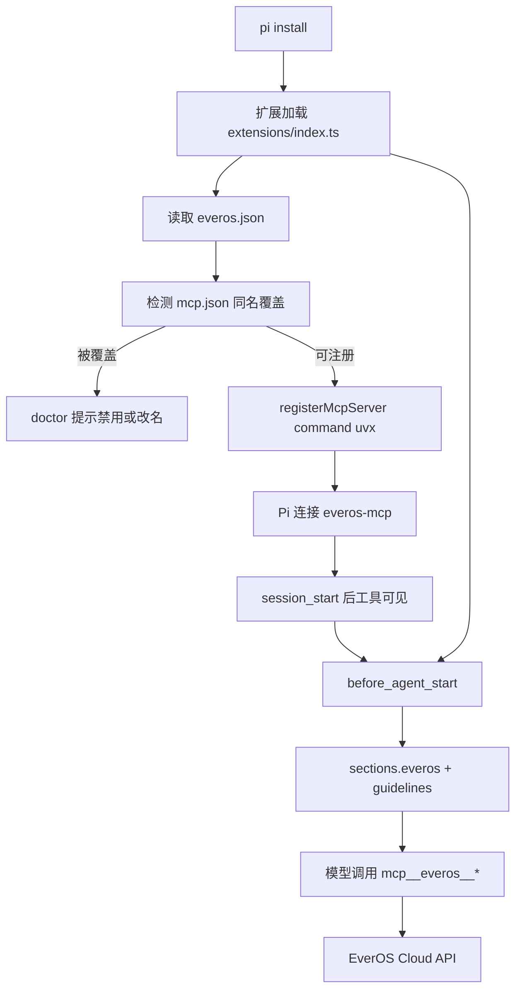

# pi-everos 实施计划

> 状态：v1 已落地；0.2.0 增加 case/skill 协议段（蒸馏仍在 Cloud）
> 目标运行时：Pi Agent CLI `@earendil-works/pi-coding-agent` 1.3.x
> 最后更新：2026-10-20

## 1. 背景与要解决的问题

EverOS Cloud 已经可以通过 MCP 提供记忆，但只配 `mcp.json` 会让模型处于“工具存在、协议不可见”：它不会主动检索或保存，用户必须明确说“查一下 EverOS”。同时现有接入依赖本机 Python 包装器、环境变量和手写 `mcp.json`，换机器就要重来。

这个项目做一个可 `pi install` 的 Pi Package，达成三件事：

- 把记忆协议写进每次运行的系统提示，模型在合适时机主动调用工具；
- 安装插件后配置一次凭据，重启 Pi 自动恢复连接；
- 由扩展在运行时注册 MCP，用户不需要为 EverOS 手写 `mcp.json`。

## 2. 已锁定决策

| ID | 决策 | 理由 |
| --- | --- | --- |
| D1 | **默认连接 = `uvx everos-mcp` + `EVEROS_API_KEY`** | 官方 Cloud 文档只提供这条路径，且给出全部 7 个工具。Plan 原稿的“OAuth 远程 MCP 默认、零 Python”目前找不到公开 URL，降为可选 spike，不挡 v1。 |
| D2 | 完整模式就是默认模式；不在 v1 打包 Python | 启动前检测 `uv`；缺失时给出安装指引，不静默失败。 |
| D3 | **双作用域用两条 MCP 连接**（`everos` + `everos-global`） | M1 已同时连上 `everos-pi` 与 `everos-global`，各 7 个工具。无需退回双查询合并。 |
| D4 | 插件不接触 token 明文落盘 | API key 只从环境变量或 Windows 凭据读取，运行期注入 stdio `env`。不写进 `everos.json`。 |
| D5 | 工具名不硬编码前缀 | 启动后读已注册工具，匹配 `mcp__<server>__<name>`，再生成提示与状态。 |
| D6 | MCP `exposure: "direct"` | Pi 默认 MCP 曝光是 `codemode`，模型看不见工具。记忆协议要主动调用，必须 `direct`。 |
| D7 | 提示注入用 `systemPromptOptions`，不替换整段 system prompt | `before_agent_start` 里写 `sections.everos` 和/或 `promptGuidelines`。返回 `systemPrompt` 会整段覆盖。 |
| D8 | 包名暂用 `pi-everos`，先本地/git 分发 | npm 发布放到 M5，不挡开发。 |

## 3. 第一版范围

### 做

- 默认：`uvx everos-mcp` 注册为 `direct` MCP（7 个工具）。
- 可开关、可编辑的系统提示注入，按实际可用工具裁剪文案。
- `/everos` 命令：`status`、`login`、`logout`、`scope`、`reconnect`、`doctor`。
- 扩展设置文件与 JSON Schema（`~/.pi/agent/extension-settings/everos.json`）。
- 全局记忆与项目记忆的显式作用域。
- 检测并提示 `mcp.json` 同名 `everos` 覆盖（本机已有此条目）。
- 中英双语文案、README。

### 暂不做

- 自建记忆后端或替换 EverOS 的抽取逻辑。
- 把扩展改成直接打 EverOS HTTP API（绕过 MCP）。
- 以 OAuth 远程 MCP 为默认（M1 若找到稳定 URL，可作为可选模式补进 M3）。
- 迁移本地 markdown、SQLite、向量库数据。
- 自动保存完整会话或每轮自动检索。
- 多账号同时在线；第一版只支持切换。
- 团队共享记忆的权限模型。
- 记忆纠错/评价入口（v1 只用 `forget_session` / 既有删除能力）。

## 4. 实现前必须复核的事实

| 事实 | 来源 | 影响 |
| --- | --- | --- |
| `pi.registerMcpServer` / `unregisterMcpServer` 存在；注册不落盘，每次 load 重注册 | Pi `docs/extensions.md` | 运行时注册，不改 `mcp.json` |
| `before_agent_start` 应改 `systemPromptOptions.sections` / `promptGuidelines`；返回 `systemPrompt` 会整段替换 | Pi `docs/extensions.md`、`system-prompt.d.ts` | 注入协议而不覆盖宿主提示 |
| 工具名格式 `mcp__<server>__<tool>`；服务器名里的 `-` 会变成 `_`；服务器名 `-`/`_` 视为同一服务器 | Pi `docs/mcp.md` + M1 | 双连接用 `everos` 与 `everos-global`；工具是 `mcp__everos__*` 与 `mcp__everos_global__*` |
| `mcp.json` 同名服务器优先于扩展注册，`/mcp` 会显示覆盖 | Pi `docs/mcp.md` | 本机已有 `everos` stdio，插件会静默失效 |
| Pi MCP 默认 `exposure` 是 `codemode` | Pi `docs/mcp.md` | 必须显式 `direct`，否则模型不直接看到工具 |
| 工厂函数里不要自己起进程/socket/timer；load 期 `registerMcpServer` 会在 `session_start` 连接 | Pi `docs/extensions.md` | 入口只注册，不 `spawn uvx` |
| 官方 Cloud MCP 是 `uvx everos-mcp` + `EVEROS_API_KEY`，7 个工具 | [docs.evermind.ai/cloud/mcp](https://docs.evermind.ai/cloud/mcp)、`llms-full.txt` | 默认路径；不是 5 工具 OAuth |
| 作用域是 env（`EVEROS_USER_ID` / `APP_ID` / `PROJECT_ID`），不是工具参数 | 同上 | 切换项目要换连接或重启进程 |
| `project_id` 没有通配符 | EverOS 文档 | 全局与项目需要两次查询后合并 |
| 本机现有 `everos`：Python 包装器读 HKCU `EVEROS_API_KEY`，`PROJECT_ID=everos-cloud-campaign` | `~/.pi/agent/mcp.json` | M1 必须先处理覆盖，才能验证插件 |

Pi 版本号与文档会漂移，升级前先跑 M1 的 spike 重新确认。

## 5. 架构



### 模块划分

| 模块 | 职责 |
| --- | --- |
| `extensions/index.ts` | 扩展入口：读设置、注册命令、注册/注销 MCP、挂载提示注入。工厂内不启动进程。 |
| `src/config.ts` | 设置读写与 schema 校验，路径 `~/.pi/agent/extension-settings/everos.json` |
| `src/mcp.ts` | 连接生命周期、`exposure: "direct"`、同名覆盖检测、`uv` 检测、重连与清理 |
| `src/prompt.ts` | 根据可用工具与作用域生成 `sections.everos`，限制 token 长度 |
| `src/scope.ts` | 解析当前工作区对应的 `project_id`，合并全局与项目检索结果 |
| `src/commands.ts` | `/everos` 子命令与状态输出 |
| `src/redact.ts` | 日志与错误信息中的密钥、token、cookie 掩码 |
| `src/credentials.ts` | 只读解析 `EVEROS_API_KEY`：进程环境 → Windows Credential Manager / 用户环境。不写设置文件。 |

### 提示注入原则

- 每次运行注入一次静态协议，不在 `before_agent_start` 里发网络请求。
- 写入 `event.systemPromptOptions.sections.everos`（独立 XML section，可随工具集更新而不打爆 prompt cache）。
- 只描述实际存在的工具；连接失败时注入“记忆暂不可用”，不教模型调用不存在的工具。
- 默认上限约 200 tokens，可在设置里关闭或替换文案。
- 召回内容放在“存储记忆，仅作参考”的边界中，避免当成指令执行。
- 只读工具可提示模型直接调用；`forget_session` 标了 `destructiveHint`，提示里要求先确认。

### 连接与命名

| 服务器名 | 用途 | env |
| --- | --- | --- |
| `everos` | 当前项目 | `EVEROS_PROJECT_ID` = 工作区映射值 |
| `everos-global` | 全局偏好 | `EVEROS_PROJECT_ID` = `global`（v1 固定，可在设置覆盖） |

不要使用 `everos_global`：Pi 把 `-` 与 `_` 当成同一服务器。

默认 `exposure: "direct"`。若双连接导致工具列表过长，M3 再考虑把 `everos-global` 降为 `codemode`。

## 6. 凭据与本机迁移

v1 认证：`EVEROS_API_KEY`。

读取顺序：

1. 进程环境变量；
2. Windows 用户环境 / Credential Manager（本机现有包装器读的是 HKCU `Environment\EVEROS_API_KEY`）；
3. 都没有 → `/everos login` 提示去 [EverOS Console](https://docs.evermind.ai/cloud/mcp) 建 key，并说明如何写入用户环境。v1 不在插件里弹浏览器 OAuth。

`/everos logout`：不删除用户系统凭据（那是共享的）；只断开本会话 MCP，并把设置里的 `enabled` 关掉。文档写清楚。

本机迁移（M1 必做）：

1. 检测到 `mcp.json` 的 `everos` 后，`/everos doctor` 明确说“文件配置覆盖了插件”。
2. 指引：禁用（`enabled: false`）或改名该条目（例如 `everos-legacy`），再 `/reload`。禁用后插件占用 `everos` 名；仅启用中的同名条目会让路到 `everos-pi`。
3. 不自动改用户的 `mcp.json`。

## 7. 目录结构

```text
pi-everos/
├── extensions/
│   └── index.ts
├── src/
│   ├── config.ts
│   ├── mcp.ts
│   ├── prompt.ts
│   ├── scope.ts
│   ├── commands.ts
│   ├── credentials.ts
│   └── redact.ts
├── schemas/
│   └── everos.schema.json
├── docs/
│   └── architecture.md
├── package.json
├── tsconfig.json
├── Plan.md
└── README.md
```

`package.json` 使用 Pi 的清单字段：

```json
{
  "name": "pi-everos",
  "keywords": ["pi-package"],
  "pi": {
    "extensions": ["./extensions/index.ts"]
  },
  "peerDependencies": {
    "@earendil-works/pi-coding-agent": "*",
    "typebox": "*"
  }
}
```

宿主提供的包只放 `peerDependencies`，不打进依赖。本地路径安装时 Pi 不会替你 `npm install`，开发期自己装 peer 或靠 `jiti` 解析到全局 Pi。

## 8. 里程碑

### M0 · 仓库与计划

- [x] 创建私有仓库与基础目录
- [x] 写 `Plan.md`
- [x] 锁定默认连接为 `uvx` + API key
- [ ] 确认 git 源安装路径（发布前）

### M1 · 技术验证（1–2 天）

目标：用**最小扩展**证明这条路径，不先写完整插件。

- [x] 最小扩展：`uvx everos-mcp` + `exposure: "direct"` + `/everos status|doctor`
- [x] 本机 `mcp.json` `everos` 覆盖：doctor 能检出；未改用户文件。`everos` 仍走 Python 包装器，插件用 `everos-pi` 验证自己的连接
- [x] `uvx everos-mcp` JSON-RPC：7 个工具（`add_memory` `search_memory` `get_profile` `list_memories` `forget_session` `record_trajectory` `recall_agent_experience`）
- [x] 真实 RPC 会话：模型主动调用 `mcp__everos_pi__get_profile` / `search_memory` / `list_memories`，全部成功
- [x] `before_agent_start` 写入 `sections.everos` 后模型会主动检索（无需用户说工具名）
- [ ] `uv` 不存在时的失败信息（本机有 uv，留到 M2 doctor 测）
- [x] 双连接成立：`everos-pi` 与 `everos-global` 同时在线，各 7 个工具
- [x] 远程 OAuth MCP：官方文档仍只有 `uvx` + API key，v1 不把它当默认

退出标准：在真实 `pi` 会话里，不改业务代码、只靠注入提示，模型能主动检索一次。**已满足。**

M1 残留：插件正式名 `everos` 仍被 `mcp.json` 占用；M2 的 doctor 要继续提示用户改名/禁用，扩展侧可先用 `everos-pi` 作为让路名，或等文件条目让开后再用 `everos`。

### M2 · 核心插件

- [x] `package.json` 清单、设置文件、schema 与默认值（`~/.pi/agent/extension-settings/everos.json`）
- [x] 提示注入（按工具集裁剪、可开关、200 token 上限）
- [x] `/everos status`、`login`、`logout`、`scope`（只读）、`reconnect`、`doctor`
- [x] 连接失败的一次性提示与降级
- [x] `mcp.json` 覆盖检测；被占用时只注册 `everos-pi` + `everos-global`
- [x] 工厂不再 `spawnSync`（审查 P1）
- [x] `forget_session` 提示要求先确认（审查 P1）

退出标准：`pi install ./pi-everos` 后无需为 EverOS 手写 `mcp.json`，新会话能自动检索一次。已有 `everos` 文件条目时 doctor 能解释如何让路。**doctor/status 已在 RPC 验证；`pi install` 未改用户 packages。**

### M3 · 作用域与加固连接

- [x] 全局/项目作用域解析与展示（`/everos scope`，可 `auto` / `project <id>` / `global <id>`）
- [x] 双连接：项目 + `everos-global`；提示里分开 search/save，先查项目再查全局
- [x] `uv` 磁盘检测 + doctor 安装指引（PATH 回退仍尝试 `uvx`）
- [x] 隔离验证：`scripts/m3-isolation.mjs` 下项目 A 标记在 B 不可见，全局标记在全局可查、项目 A 不可见
- [x] OAuth 远程仍无稳定 URL，不加入 v1

退出标准：项目 A/B 不串数据，全局偏好仍可查。**已满足。**

### M4 · 加固

- [x] plan 模式只读：拦截 `add_memory` / `forget_session` / `record_trajectory`（读最新 `plan-mode` session entry）
- [x] 密钥掩码：`redact` / `redactRecord`；设置文件不写 key；doctor 报告再掩码
- [x] MCP `timeout: 60`；工具失败只提示一次并让主对话继续；`/everos reconnect` 恢复
- [x] `session_shutdown` 注销本插件注册的 MCP，避免重复加载残留连接
- [x] 中英文案：`PI_LANG`/`LANG` 选择（plan 拦截、启动警告）
- [x] `/everos doctor` 输出 `----- pi-everos doctor -----` 可复制块

验证：`npm test`（12 passed）。

### M5 · 发布

- [x] README 与架构说明
- [x] `npm pack` 检查包内容
- [ ] 演示录屏（可选，跳过）
- [x] `CHANGELOG.md` + `0.1.0`（未打 git tag、未 commit）
- [ ] git 源 / npm 发布（本机先 `pi install` 本地路径）

## 9. 验收矩阵

| 场景 | 期望 | 验证方式 |
| --- | --- | --- |
| 首次安装 | `pi install` 后启动即可见 `/everos` | 真实 CLI |
| 覆盖检测 | 存在 `mcp.json` `everos` 时 doctor 警告，不静默失效 | 本机现有配置 |
| 凭据 | 有 `EVEROS_API_KEY` 即可连；设置文件无明文 | 读 `everos.json` + 会话日志 |
| 主动检索 | 只说“按我之前的偏好”即触发检索 | 会话日志 |
| 主动保存 | “记住……”写入项目层 | 新会话召回 |
| 拒绝保存 | “这条别记”不产生新记忆 | 云端条目对比 |
| 项目隔离 | A 的项目记忆在 B 不可见 | 两目录对照 |
| 离线 | 提示一次，主对话继续 | 断网 |
| 密钥安全 | 配置、日志、session、bundle 无明文 | 全文搜索 |
| 兼容 | 现有其他 MCP 与扩展正常 | `/mcp` 与回归会话 |
| 工具曝光 | `/mcp` 显示 everos 为 `direct`，模型不需 codemode 即可调用 | 会话 |

## 10. 风险与缓解

| 风险 | 缓解 |
| --- | --- |
| `mcp.json` 同名覆盖导致插件静默失效 | 启动检测；doctor 说明如何禁用/改名；不自动改文件 |
| 默认 `codemode` 使模型从不直接调记忆工具 | 强制 `exposure: "direct"` |
| 没有 `uv` | doctor + login 给出安装命令；Windows 写明 winget/scoop/官方脚本 |
| 提示注入占用过多上下文 | 200 token 上限，默认开启可关 |
| 双连接重复展示工具 | 统一命名与去重，`/mcp` 中标注用途 |
| Windows 凭据来源不统一（注册表 vs Credential Manager vs env） | 读取顺序写死；doctor 打印“从哪里读到 key”（掩码） |
| Pi API 版本漂移 | 以 1.3.x 为基线，升级前跑 M1 |
| 轨迹记录产生噪声 | 仅 >3 轮工具调用的任务触发 `record_trajectory` |
| 官方若上线远程 OAuth MCP | 保持 `mode` 可扩展，不把 stdio 写死进提示文案 |

## 11. 设置草案

`~/.pi/agent/extension-settings/everos.json`：

```json
{
  "$schema": "./schemas/everos.schema.json",
  "enabled": true,
  "mode": "uvx",
  "userId": "chasen-demo",
  "appId": "pi",
  "projectId": "auto",
  "globalProjectId": "global",
  "prompt": {
    "enabled": true,
    "maxTokens": 200
  }
}
```

- `projectId: "auto"`：由工作区路径派生（可覆盖）。
- 不包含 `apiKey`。
- `mode` 预留 `"oauth"`，v1 只实现 `"uvx"`。

## 12. 发布顺序

1. 本地路径安装：`pi install ./pi-everos`，用于开发验证。
2. git 源安装：`pi install git:github.com/Chasen-Liao/pi-everos`。
3. npm 发布：确认包名与内容后执行 `npm publish`，README 更新为 `pi install npm:pi-everos`。
