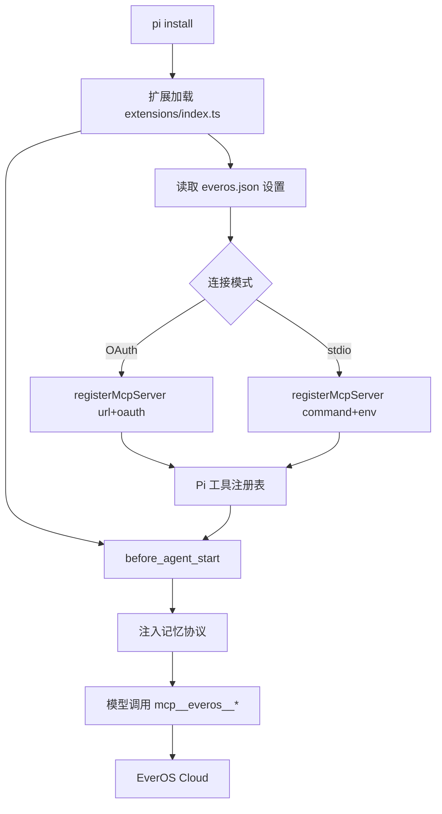

# pi-everos 实施计划

> 状态：M0 规划中
> 目标运行时：Pi Agent CLI `@earendil-works/pi-coding-agent` 1.3.x
> 最后更新：2026-10-19

## 1. 背景与要解决的问题

EverOS Cloud 已经通过 MCP 暴露记忆能力，但只配置 MCP 会让模型处于“工具存在、能力不可见”的状态：它不会主动检索或保存，用户必须明确说“查一下 EverOS”。同时现有接入依赖 Python 运行时、环境变量和手写 `mcp.json`，换机器就要重来。

这个项目做一个可 `pi install` 的 Pi Package，达成三件事：

- 把记忆协议写进每次运行的系统提示，模型在合适时机主动调用工具；
- 安装插件后登录一次，凭据持久保存，重启 Pi 自动恢复连接；
- 由扩展在运行时注册 MCP，用户不需要编辑 `mcp.json`。

## 2. 第一版范围

### 做

- OAuth 远程连接（5 个工具）作为默认模式，零 Python 依赖。
- 可选完整模式：通过 `uvx everos-mcp` 启动 stdio（7 个工具，含轨迹与 Agent 经验）。
- 可开关、可编辑的系统提示注入，按实际可用工具裁剪文案。
- `/everos` 命令：`status`、`login`、`logout`、`scope`、`reconnect`、`doctor`。
- 扩展设置文件与 JSON Schema。
- 全局记忆与项目记忆的显式作用域。
- 中英双语文案、README、演示录屏。

### 暂不做

- 自建记忆后端或替换 EverOS 的抽取逻辑。
- 迁移本地 markdown、SQLite、向量库数据。
- 自动保存完整会话或每轮自动检索。
- 多账号同时在线；第一版只支持切换。
- 团队共享记忆的权限模型。

## 3. 实现前必须复核的事实

| 事实 | 来源 | 影响 |
| --- | --- | --- |
| 扩展 API 提供 `pi.registerMcpServer` / `pi.unregisterMcpServer` | `docs/extensions.md` | 运行时注册连接，不改 `mcp.json` |
| `before_agent_start` 可返回提示增量或 guidelines | `docs/extensions.md` | 注入协议而不整体替换 systemPrompt |
| 工具名格式为 `mcp__<server>__<tool>` | `docs/mcp.md` | 提示文案必须动态取实际工具名 |
| `mcp.json` 同名服务器优先于扩展注册 | `docs/mcp.md` | 已存在的 `everos` 条目会覆盖插件注册 |
| 远程 OAuth connector 只有 5 个工具 | EverOS `llms-full.txt` | 缺 `record_trajectory`、`recall_agent_experience` |
| stdio 版有 7 个工具 | EverOS `llms-full.txt` | 完整模式必须管理 Python/uv |
| 作用域是服务端环境变量，不是工具参数 | EverOS `llms-full.txt` | 切换项目需要换连接或重启进程 |
| `project_id` 没有通配符 | EverOS 文档 | 全局与项目需要两次查询后合并 |

Pi 版本号与文档会漂移，升级前先跑 M1 的 spike 重新确认。

## 4. 架构



### 模块划分

| 模块 | 职责 |
| --- | --- |
| `extensions/index.ts` | 扩展入口：读设置、注册命令、注册/注销 MCP、挂载提示注入 |
| `src/config.ts` | 设置读写与 schema 校验，路径 `~/.pi/agent/extension-settings/everos.json` |
| `src/mcp.ts` | 连接生命周期、模式切换、同名覆盖检测、重连与清理 |
| `src/prompt.ts` | 根据可用工具与作用域生成提示块，限制 token 长度 |
| `src/scope.ts` | 解析当前工作区对应的 `project_id`，合并全局与项目检索结果 |
| `src/commands.ts` | `/everos` 子命令与状态输出 |
| `src/redact.ts` | 日志与错误信息中的密钥、token、cookie 掩码 |

### 提示注入原则

- 每次运行注入一次静态协议，不在 `before_agent_start` 里发网络请求。
- 只描述实际存在的工具；连接失败时注入“记忆暂不可用”，不教模型调用不存在的工具。
- 默认上限 200 tokens，可在设置里关闭或替换文案。
- 召回内容放在“存储记忆，仅作参考”的边界中，避免当成指令执行。

## 5. 技术决策

### D1. 默认连接方式（待 M1 验证后定稿）

倾向：OAuth 远程作为默认，开箱即用；stdin 完整模式作为可选项。理由是安装成本最低，符合“装插件就能用”的目标。代价是缺两个 Agent 经验工具，`/everos status` 与 README 必须明示。

备选：直接默认 stdio，换取 7 个工具，但要求用户安装 `uv` 或 Python，违背低门槛目标。

### D2. 完整模式的运行时

第一版调用 `uvx everos-mcp`，启动前检测 `uv` 是否存在；不存在时给出安装指引并提供留在 OAuth 模式的选项。不在第一版打包 Python 运行时。

### D3. 双作用域实现

优先评估“两条 MCP 连接”（global 与当前项目各一条），因为它们互不干扰且切换成本低；若 Pi 对同名或双连接有限制，退回“单连接 + 插件侧两次检索合并”。两条路线都要在 M1 做最小验证。

### D4. 凭据

- OAuth：交给 Pi 的 MCP 登录与凭据存储，插件不接触 token。
- API key：只从用户环境变量或 Windows Credential Manager 读取；运行期注入 stdio env，不写入设置文件。

### D5. 工具命名

不硬编码前缀。启动后读取已注册工具列表，匹配 `mcp__<server>__<name>`，再生成提示与状态；找不到时降级。

## 6. 目录结构

```text
pi-everos/
├── extensions/
│   └── index.ts
├── src/
│   ├── config.ts
│   ├── mcp.ts
│   ├── prompt.ts
│   ├── scope.ts
│   ├── commands.ts
│   └── redact.ts
├── schemas/
│   └── everos.schema.json
├── docs/
│   └── architecture.md
├── package.json
├── tsconfig.json
├── Plan.md
└── README.md
```

`package.json` 使用 Pi 的清单字段：

```json
{
  "name": "pi-everos",
  "keywords": ["pi-package"],
  "pi": {
    "extensions": ["./extensions/index.ts"]
  },
  "peerDependencies": {
    "@earendil-works/pi-coding-agent": "*",
    "typebox": "*"
  }
}
```

宿主提供的包只放 `peerDependencies`，不打进依赖。

## 7. 里程碑

### M0 · 仓库与计划

- [x] 创建私有仓库与基础目录
- [x] 写 `Plan.md`
- [ ] 确认包名与发布渠道（npm 或 git）

### M1 · 技术验证（1–2 天）

- [ ] 最小扩展调用 `pi.registerMcpServer` 注册 EverOS OAuth，确认 `/mcp` 能登录
- [ ] 重启 `pi` 验证凭据持久化与自动重连
- [ ] 打印工具列表，确认 OAuth 5 个工具与命名
- [ ] 用 stdio 连接确认 7 个工具
- [ ] 验证现有 `everos` 条目对扩展注册的覆盖行为
- [ ] 验证 `before_agent_start` 返回提示增量在真实会话中生效

退出标准：两种模式都能在真实 `pi` 会话里完成一次检索。

### M2 · 核心插件

- [ ] 设置文件、schema 与默认值
- [ ] 提示注入（按工具集裁剪、可开关）
- [ ] `/everos status`、`login`、`logout`、`reconnect`
- [ ] 连接失败的一次性提示与降级

退出标准：安装后无需改 `mcp.json`，新会话能自动检索一次。

### M3 · 作用域与完整模式

- [ ] 全局/项目作用域解析与展示
- [ ] 双连接或双查询合并
- [ ] `uvx` 完整模式与运行时检测
- [ ] 项目切换后的隔离验证

退出标准：项目 A/B 不串数据，全局偏好仍可查。

### M4 · 加固

- [ ] plan 模式只读
- [ ] 密钥掩码与日志检查
- [ ] 超时、退避、断网恢复
- [ ] 重复加载、升级、卸载无残留
- [ ] 中英文案

### M5 · 发布

- [ ] README 与架构说明
- [ ] `npm pack` 检查包内容
- [ ] 演示录屏
- [ ] 版本 tag 与变更记录

## 8. 验收矩阵

| 场景 | 期望 | 验证方式 |
| --- | --- | --- |
| 首次安装 | `pi install` 后启动即可见 `/everos` | 真实 CLI |
| 登录持久化 | 重启后 `status` 仍为已连接 | 关闭再开 `pi` |
| 主动检索 | 只说“按我之前的偏好”即触发检索 | 会话日志 |
| 主动保存 | “记住……”写入项目层 | 新会话召回 |
| 拒绝保存 | “这条别记”不产生新记忆 | 云端条目对比 |
| 项目隔离 | A 的项目记忆在 B 不可见 | 两目录对照 |
| 离线 | 提示一次，主对话继续 | 断网 |
| 密钥安全 | 配置、日志、session、bundle 无明文 | 全文搜索 |
| 兼容 | 现有 MCP 与扩展正常 | `/mcp` 与回归会话 |

## 9. 风险与缓解

| 风险 | 缓解 |
| --- | --- |
| `mcp.json` 同名覆盖导致插件静默失效 | 启动检测并提示复用或改名 |
| OAuth 只有 5 个工具 | 状态与提示按能力裁剪，明示缺失 |
| 提示注入占用过多上下文 | 200 token 上限，默认开启可关 |
| 双连接重复展示工具 | 统一命名与去重，`/mcp` 中标注用途 |
| Windows 凭据存储差异 | 优先 OAuth；API key 模式写清限制 |
| Pi API 版本漂移 | 以 1.3.x 为基线，升级前跑 M1 |
| 轨迹记录产生噪声 | 仅 >3 轮工具调用的任务触发 |

## 10. 待确认

- 包名与 npm scope：`pi-everos` 是否可用，或先用 git 源分发。
- 全局作用域的 `project_id` 命名约定：固定 `global` 还是用户自定义。
- v1 是否提供记忆纠错/评价入口，还是只做删除。
- 是否需要把 `/everos doctor` 输出导出为可粘贴的诊断报告。

## 11. 发布顺序

1. 本地路径安装：`pi install ./pi-everos`，用于开发验证。
2. git 源安装：`pi install git:github.com/Chasen-Liao/pi-everos`。
3. npm 发布：确认包名与内容后执行 `npm publish`，README 更新为 `pi install npm:pi-everos`。

