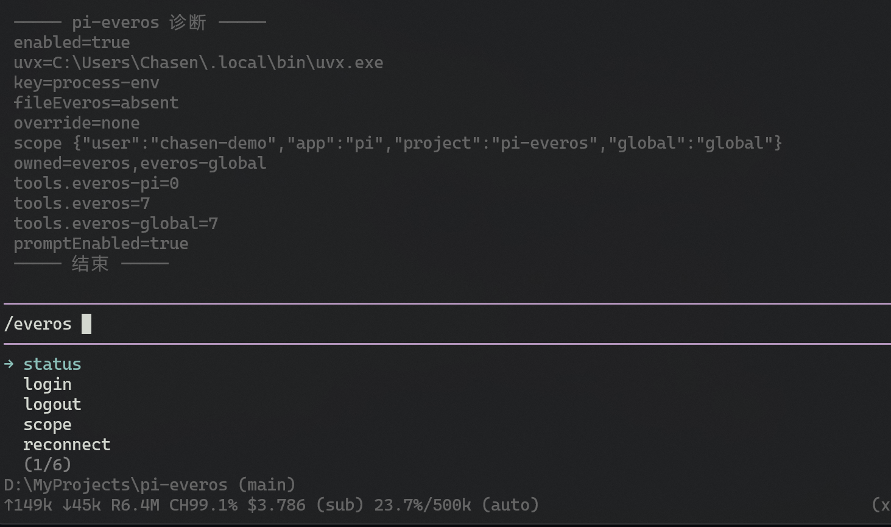

# pi-everos

> **官方入口：** 已提交到 [EverMind-AI/Plugins](https://github.com/EverMind-AI/Plugins) 的 [`pi/`](https://github.com/EverMind-AI/Plugins/tree/main/pi)（[PR #33](https://github.com/EverMind-AI/Plugins/pull/33)）。
>
> 本仓库继续作为 `pi install git:` / npm 的安装源（Pi 不能装 git 子目录）。两边怎么同步见 [MAINTENANCE.md](./MAINTENANCE.md)。



给 Pi Agent 接上 [EverOS Cloud](https://everos.evermind.ai) 云端记忆。安装后自动注册 `uvx everos-mcp`（`exposure: direct`），并把记忆协议注入每次运行，模型会自己检索和保存，不必每次说「去查 EverOS」。

- 产品：[EverOS Cloud](https://everos.evermind.ai)
- 接入：[EverOS MCP 文档](https://docs.evermind.ai/cloud/mcp.md)
- 作用域：[API 与记忆作用域](https://docs.evermind.ai/llms.txt)

用户记忆协议段默认英文（受 `prompt.maxTokens` 限制）。agent 经验（case/skill）另有一段 `everos-agent`，不受该上限挤压。`/everos` 命令与 doctor 跟随 `PI_LANG`/`LANG`（`zh` 用中文）。

## 需要

- [Pi Agent CLI](https://github.com/badlogic/pi-mono) 1.3+
- [uv](https://docs.astral.sh/uv/)，用来跑 `uvx everos-mcp`
- 环境变量 `EVEROS_API_KEY`（在 [EverOS Cloud](https://everos.evermind.ai) 创建；**不要**写进设置文件）

## 安装

```bash
pi install npm:pi-everos
```

本仓库（Pi 不能装 git 子目录，所以 git 安装仍指向这里）：

```bash
pi install git:github.com/Chasen-Liao/pi-everos
```

官方仓（clone 后装子目录）：

```bash
git clone https://github.com/EverMind-AI/Plugins.git
pi install ./Plugins/pi
```

装好后新开一个 Pi 会话，可用 `/everos doctor` 检查连接。

若 `~/.pi/agent/mcp.json` 里已有**启用的** `everos` 条目，文件配置会覆盖插件，插件改用 `everos-pi`。把该条目设为 `enabled: false` 或改名后 `/reload`，插件即可占用 `everos`。插件不会改你的 `mcp.json`。

## 命令

```text
/everos status
/everos login
/everos logout
/everos scope
/everos reconnect
/everos doctor
```

- 登录不把 API key 写入 `everos.json`。设好用户环境变量后 `/everos login` 或 `/everos reconnect` 会重新读 key。
- `/everos logout` 只断开本插件并写入 `enabled: false`，**不删除**系统里的 `EVEROS_API_KEY`。

## 作用域

- 项目连接：当前工作区（`projectId: auto` 时用**目录名**）
- 全局连接：`everos-global`（默认 `global`）
- `/everos scope auto|project <id>|global <id>` 可改映射
- agent 身份：`assistantSenderId`（默认 `assistant-<userId>`）。case/skill 挂在这个 id 上；改了会看不到旧经验

## Agent 经验

EverOS 把完整任务轨迹蒸馏成 **case**（一次怎么做的），相近 case 再聚成 **skill**（可复用做法）。插件不在本地提取：模型调用 `record_trajectory` / `recall_agent_experience`，Cloud 后台完成蒸馏（数秒到数分钟）。

- 轨迹默认写入**当前项目**；只有用户明确要求记下跨项目习惯时才写全局
- 召回先查项目，没有相关经验再查全局
- 需要超过三轮工具调用才会生成 case；更短的轨迹不要 `record_trajectory`
- `forget_session` 删除本会话记忆和 case，**保留**已经学到的 skill

## 开发

```bash
npm test
pi -e ./extensions/index.ts
```

架构见 [docs/architecture.md](./docs/architecture.md)。

## 限制

- 默认是 `uvx everos-mcp` + API key，7 个工具。
- 远程 OAuth MCP 不是 v1 默认。
- plan 模式会拦截 `add_memory` / `forget_session` / `record_trajectory`。
- `forget_session` 会先向你确认；不会删除已学到的 skill。
